# From Nudging a Patch of Field to Watching the World Learn to Self-Correct

## GeNewWord Continuous Local Energy Response × Agent/Feedback Play and Build Guide

> **Language:** **English (canonical guide)** · [中文（完整译文）](continuous-local-energy-response-guide.zh-CN.md)

This is the canonical English guide. The Chinese page is its complete translation, preserving the same play instructions, build philosophy, formulas, validation paths, and safety boundaries.

- **Last verified:** 2026-08-10
- **Current status:** Implemented and validated at Level 3 causal direction within a bounded envelope
- **Who this is for:** People discovering the project, people who want to play immediately, people who want to understand the design, and developers preparing to continue the work

> In one sentence: this is not “watching a prerecorded animation.” It is a playable causal laboratory where you can use the mouse to add force to or drain force from a local part of the world, let the same world state genuinely evolve, and then let Pattern, Trace, Agent, and Feedback interpret the consequence and affect what happens next.

If you want to start immediately, jump to the [Three-Minute Quick Start](#three-minute-quick-start). If you want to know why the system is built this way, read [Building Philosophy](#building-philosophy). You can also go straight to [Exporting Raw Data](#exporting-and-inspecting-raw-data), [Formal Validation](#how-to-verify-this-is-not-just-a-show), or [FAQ](#faq-and-troubleshooting).

Related sources of fact:

- [Current public status](status.md)
- [Architecture and authority model](architecture.md)
- [Release checklist](../RELEASE_CHECKLIST.md)

---

## In Plain Language: What Is This?

Imagine a bell.

- Strike it, and the bell is excited; vibration spreads outward.
- Press your hand against it, and the vibration is damped.
- How hard you strike or press is `amplitude`.
- Whether you use a pointed hammer or a broad soft mallet is `radius`.
- Whether you tap and release or keep applying force is `duration`.
- How the bell deforms, decays, and recovers is the Field’s subsequent evolution.
- The world recognizing “there is a continuously existing structure here” is Pattern.
- The world recording what it just experienced is Trace.
- Agent compares “how the structure is now” with “how it should be,” then decides whether to correct it.
- Feedback is a provenance-bearing candidate correction; only Feedback that passes the next-tick application-time gate and is marked `applied` actually changes the later Field.

GeNewWord’s “bell” is not a hard-coded bell model. A closer metaphor is that the world is a structured, damped, coupled field. The objects, material tendencies, and stable structures you see are effective organizations formed by that field under constraints.

The metaphor is only there to help. The current implementation is not an acoustic simulation, and it does not claim to simulate real materials, thermodynamics, or fundamental cosmic physics.

### What It Is Today

Today, it is:

1. a local-field interaction window you can actually operate in a browser;
2. a system with real canonical Field-state changes, not merely changed colors or labels;
3. a bounded energy-response system that tracks input, dissipation, coupling, a boundary proxy, and residual;
4. a system that carries continuous response into a Pattern → Trace → Agent → Feedback loop;
5. a causal vertical that can prove the later Field differs when Feedback is enabled versus disabled; and
6. an engineering laboratory that can export, recompute, replay, and reject forged evidence.

### What It Is Not Yet

It is not yet:

- a content-complete game with levels, characters, and finished art;
- a universal physical-universe simulator;
- a conversational LLM NPC system;
- a classifier that treats “FivePhase labels” as the ontology of the world;
- a multiplayer network, blockchain, wallet, token, or consensus system; or
- a production server that permanently preserves every world across processes.

The most accurate product description is: **a playable, causally real world-engine vertical and research cockpit.**

---

## Three-Minute Quick Start

### 1. Start the Live World

Open a terminal and enter the repository:

```bash
cd /path/to/geneword-engine
python3 scripts/serve_implicit_3d_field_window.py \
  --host 127.0.0.1 \
  --port 8766 \
  --run-id energy-playground \
  --max-advance-ticks 8
```

The server is ready when you see:

```text
Serving implicit 3D live field viewer at http://127.0.0.1:8766/viewer.html
```

Then open this address in a browser:

```text
http://127.0.0.1:8766/viewer.html
```

The service is bound only to the local machine at `127.0.0.1`; the public preview refuses non-loopback binds. It has no user authentication or TLS. **Do not expose the port through a proxy or tunnel to an untrusted network.** When you finish playing, return to the terminal and press `Ctrl-C`.

### 2. Do Not Let the Cockpit Intimidate You

The page looks like a spacecraft packed with instruments. For your first run, you only need these controls:

1. `mode`
2. `interact`
3. `tool`
4. `radius`
5. `amplitude`
6. `duration`
7. the central canvas

You can ignore the other material layers, debug layers, route readouts, and long-running experiment information for now.

### 3. Run Your First “Strike the Bell” Experiment

Use these settings:

| Control | Value |
| --- | --- |
| `mode` | `Inspect Tick` |
| `interact` | checked |
| `tool` | `local_excite` |
| `radius` | `1` |
| `amplitude` | `0.3` |
| `duration` | `2.25` |

Click a clearly visible structure near the center of the canvas.

This action does not “paint a bright dot on the canvas.” The Viewer converts the click into a world coordinate along the current camera ray and submits a real interaction to the live session with the current frame, state, and ray lineage. After the interaction is accepted, the default UI advances four world ticks so you can immediately see the force application and the beginning of relaxation.

`duration=2.25` is split into:

```text
[1.0, 1.0, 0.25]
```

With `amplitude=0.3`, the three scheduled doses are therefore `0.3`, `0.3`, and `0.075`. A Viewer interaction automatically advances four ticks, so this pulse finishes within one click. If `duration > 4`, the remaining applications stay in the pending queue; continue with `Play` or `Advance`.

### 4. Run a “Press Against the Bell” Experiment

Keep the click in roughly the same area, and change the settings to:

| Control | Value |
| --- | --- |
| `tool` | `local_dampen` |
| `radius` | `2` |
| `amplitude` | `0.2` |
| `duration` | `1.5` |

Click the canvas again.

You do not enter a negative number. `amplitude` is always a non-negative magnitude; the tool supplies the direction:

- `local_excite` → positive excitation;
- `local_dampen` → negative damping.

### 5. Let the World Keep Moving

Switch `mode` to `Run World`, then click `Play`.

The world evolves one tick at a time. You can watch structures continue to deform, decay, and recover, and see whether subsequent Pattern, Agent, and Feedback records appear. Click `Pause` to stop automatic advancement.

### 6. Read the Evidence, Not Just the Color

Find the Timeline and audit panel on the right side of the page or below the main view. On your first run, search for these fields:

```text
implicit_interaction_audit
five_phase_live_summary_v1
pattern_response
stability_score
q_user
Q_live
energy_response
ledger_count
feedback_application
viewer_generated: false
display_only: true
is_authority_state: false
```

When these records are present, you are seeing more than a visual effect: you have a provenance chain from user input through world state, measurement, Pattern, Agent/Feedback, and the later Field.

---

## The Core of Play: What Are You Actually Controlling?

### The Three Most Important Knobs

| Parameter | Intuitive metaphor | Current live implicit boundary | Actual effect |
| --- | --- | --- | --- |
| `amplitude` | how hard you strike or press | `0 ≤ amplitude ≤ 1` | per-tick control strength; the tool determines the positive or negative direction |
| `radius` | the width of the hammerhead or brush | `0 < radius ≤ 4` | changes local support and the weight distribution across multiple bases |
| `duration` | how long you keep applying force | `0 < duration ≤ 32` | accepts integer and fractional ticks; the final tick may have a partial weight |

> Note: the generic Viewer input allows `radius` values up to 16, but the real backend limit for the current live implicit interaction is 4. Use `1–4` for this capability; the backend correctly rejects values above 4.

### The Tools Are One Directional Axis, Not Two Physics Systems

`local_excite` and `local_dampen` look like two tools, but underneath they are the positive and negative directions of one continuous control surface:

```text
signed_amplitude = +amplitude  # excite
signed_amplitude = -amplitude  # dampen
```

That matters. It prevents an “excitation system” and a “damping system” from growing separate, inconsistent states, rules, and evidence.

### Radius Does Not Draw a Bigger Circle on the Screen

The click first identifies a world target point along the current observation ray. The backend then uses a compactly supported Wendland C2 kernel to compute local weights for nearby bases:

```text
kappa(r) = (1-r)^4 (4r+1),  0 ≤ r < 1
kappa(r) = 0,               r ≥ 1
```

The unnormalized `kappa` fixes the accounting region for the experiment. Normalized weights distribute the control dose among bases near the target.

Changing radius therefore changes which local components participate and by how much. It does not merely change a UI halo.

### Why Duration Can Be 1.5 or 2.25

A fractional duration is not secretly rounded. The `k`th scheduled weight is:

```text
h_k = min(1, max(0, duration - k))
```

Examples:

| duration | schedule weights |
| --- | --- |
| `0.5` | `[0.5]` |
| `1.0` | `[1.0]` |
| `1.5` | `[1.0, 0.5]` |
| `2.25` | `[1.0, 1.0, 0.25]` |

The total requested absolute dose is `amplitude × duration`, while each tick remains subject to the session-level safety budget.

---

## Six Suggested Ways to Play

### Scenario 1: A Light Strike and a Heavy Strike

Hold `radius=1` and `duration=1` fixed, then try:

```text
amplitude = 0.1
amplitude = 0.2
amplitude = 0.3
```

What to watch: the Field responses should be graded, rather than all three settings triggering the same animation.

Ask yourself whether the response grows continuously or becomes visibly nonlinear in some region. Current acceptance requires bounded response in a small neighborhood; it does not require the whole world to remain linear forever.

This manual sequence is good for intuition, but it is not a strict controlled experiment because the previous click has already changed the same live session. For a strict comparison, use the same-S0 continuous runner later in this guide. It forks every amplitude from the same trusted initial snapshot.

### Scenario 2: Needle Point and Soft Brush

Hold `amplitude=0.2` and `duration=1` fixed, then compare:

```text
radius = 1
radius = 3
```

What to watch: the total force can remain close, while the local kernel, participating bases, and spatial response differ.

### Scenario 3: Tap and Release Versus Sustained Force

Hold `amplitude=0.2` and `radius=2` fixed, then compare:

```text
duration = 1
duration = 1.5
duration = 2.25
```

What to watch: the number of applications and the schedule weights in the audit. Advance the different experiments to the same final horizon before comparing them; do not force a comparison between images from different ticks.

### Scenario 4: Excite First, Then Dampen

First apply this to one local area:

```text
local_excite / amplitude 0.3 / radius 1 / duration 2.25
```

Then apply:

```text
local_dampen / amplitude 0.2 / radius 2 / duration 1.5
```

What to watch: how the input sign, energy proxy, Pattern deformation, and relaxation change. Do not look only for whether “the color got darker.”

### Scenario 5: Wait for the World to Correct Itself

After a perturbation, switch to `Run World` and let the world advance for several ticks.

What to watch:

- whether a matched Pattern appears;
- whether Agent reads the corresponding Trace/residual;
- whether `feedback_application` is `applied` or empty;
- if it is applied, whether the candidate’s absolute error is strictly smaller than the feedback-off baseline; and
- whether the later Field is genuinely different.

Feedback is not guaranteed to act every time, and there is no Viewer switch that forces it on for the sake of a demonstration. If there is no reliable immediate predecessor, sensitivity is too small, direction is ineligible, or the candidate cannot strictly improve the error, the correct behavior is to consume that Feedback opportunity while submitting an empty projection.

### Scenario 6: Prove That “Looking” Does Not Secretly Change the World

Switch to `Inspect Tick`, note the current `tick`, then click `cam forward`, `orbit left`, or `yaw right`.

The correct result is:

- the frame count increases;
- camera/observer records update;
- the world tick does not change; and
- the Field, Pattern, Agent, and Feedback family counts do not increase.

This is the separation between observation authority and world authority: viewing the world from a different angle does not let the camera create world history.

---

## Three Playback Modes

| Mode | What it does | Does it advance the world? | Best used for |
| --- | --- | --- | --- |
| `Run World` | each `Play` step submits a real world step | yes | watching ongoing evolution, relaxation, and Feedback consequences |
| `Inspect Tick` | holds one world tick while moving among observation frames | camera movement does not | fixed-point observation, interaction, and camera-inertness checks |
| `Replay Artifact` | `Play`/slider reviews existing audit/projection frames; camera is disabled | playback itself does not, but `Advance`/interaction still write when connected to a live backend | reviewing provenance; use the validation-generated static artifact Viewer for strong read-only behavior |

The `Advance` button currently advances four ticks at a time. When the Viewer submits `local_excite` or `local_dampen`, it also automatically advances four ticks after acceptance.

`Replay Artifact` is a playback semantic, not a permission boundary. In a live Viewer, `Advance` and enabled interaction remain connected to real write endpoints; do not use them during a read-only audit. For strong read-only viewing, open the static artifact Viewer generated by a validation runner, which has no live backend.

### Tick and Frame Are Not the Same Thing

This is the easiest distinction to misunderstand:

- `tick`: the canonical world genuinely evolved by one step;
- `frame`: one observation or projection of a world state for a particular observer.

You can therefore see:

```text
frame 17 -> frame 18
tick 9  -> tick 9
```

That usually means the camera moved or the state was rendered again. It does not mean the world froze or the record is broken.

---

## How to Read the Cockpit

### Layer 1: What Did I Do?

Read `implicit_interaction_audit`:

- request/command/audit ID;
- source frame/state/ray lineage;
- tool;
- signed amplitude;
- radius;
- duration and schedule;
- target world point and target basis; and
- the accepted → in_progress → applied lifecycle.

### Layer 2: What Happened to the World?

Read `implicit_live_step` and `energy_response`:

- previous/result state ID and digest;
- whether the tick advanced exactly once;
- raw/realized user projection;
- raw/realized Feedback projection;
- merged projection;
- fixed-scene ledger; and
- an independent ledger for every active local scope.

The most important energy-ledger fields are:

| Field | Intuitive meaning |
| --- | --- |
| `energy_before/after` | the quadratic response proxy before and after this declared scope |
| `d_decay` | the amount removed by decay |
| `x_internal` | coupling exchange inside the scope |
| `f_boundary_proxy` | proxy for coupling across the scope boundary |
| `i_user` | user-input contribution |
| `i_feedback` | Feedback-input contribution |
| `d_clip` | dissipation caused by numerical clipping |
| `residual` | the closure residual after subtracting the terms above |

These are recomputable energy, boundary, and dissipation proxies inside the current discrete runtime. They are not physical SI units or universal conservation laws.

### Layer 3: How Does the World Interpret the Consequence?

Read `five_phase_live_summary_v1`:

- dominant/aggregate phase;
- Pattern occurrence ID, persistent identity, and the complete `pattern_response` summary;
- Trace IDs and Feedback record IDs;
- user/Feedback projection and scoped energy-ledger summaries; and
- Feedback-application eligibility, baseline/candidate measurements, and applied digest.

This Viewer summary is intentionally bounded. It does not embed the complete continuous signed bridge, phase/constraint records, Trace body, residual constraint, or Agent state. Use `/export` to inspect those full records. The Viewer remains a consumer of serialized summaries and cannot invent missing facts.

The five FivePhase components are:

```text
contractive / generative / transport / radiant / substrate
```

For intuition, you can read them as five classes of measured feature: contraction, generation, transport, radiation, and substrate. They are downstream descriptions extracted from continuous response. They are not five independent substances, and they cannot manufacture Field facts in reverse.

### Stability Is Not a Leaderboard Score

A live Pattern’s perturbation response uses one fixed identity support:

```text
d = |E_current - E_setpoint| / max(E_setpoint, eps)
q_user = ||u_user||_kappa / max(||c_setpoint||_kappa, eps)
Q_live = cumulative user-only q_user within the perturbation episode
S_live = 1 / (1 + d / max(Q_live, eps))
relaxation = d / max(d_peak, eps)
```

How to read it:

- larger `d` means the structure is farther from its episode setpoint;
- `Q_live` is the cumulative perturbation dose actually applied by the user to this fixed support;
- `S_live` describes relative deformation response per unit of cumulative perturbation; and
- `relaxation` describes how much of the peak deformation remains.

Feedback dose is recorded separately and is not mixed into `Q_live`. Otherwise, Agent’s own correction would contaminate the question “how much response did the user’s perturbation cause?”

### Feedback Is Not a Sentence of Advice; It Is a Candidate Correction with Consequences

Agent first reads Pattern/Trace/residual and the setpoint error. The system estimates sensitivity with a finite difference at the target basis and forms a signed candidate. At application time, the session constructs two results under the same lock from the same pre-tick state:

1. the feedback-off baseline after decay/coupling/user input;
2. the same baseline plus candidate Feedback.

Only when:

```text
candidate absolute error < baseline absolute error - 1e-12
```

does the candidate become the Feedback input for this canonical transition. Otherwise, the session commits the baseline and records Feedback as ineligible or as an empty application.

---

## Causal Chain: How One Click Becomes Later World History

```mermaid
flowchart LR
    U["Player clicks the canvas"] --> V["Viewer assembles frame/state/ray lineage"]
    V --> S["ImplicitFieldSession locks and accepts the interaction"]
    S --> P["Local signed control descriptor and schedule"]
    P --> F1["Canonical ImplicitFieldState transition"]
    F1 --> E["Fixed/local energy ledgers"]
    F1 --> M["Continuous signed measurement bridge"]
    M --> C["Constraint / FivePhase field"]
    C --> PAT["Pattern occurrence + persistent identity"]
    PAT --> T["Trace + residual memory"]
    T --> A["Agent setpoint/error interpretation"]
    A --> FB["Signed Feedback candidate"]
    FB --> G["Application-time feedback-off vs candidate gate"]
    G --> F2["Later canonical Field transition"]
    F2 --> R["Completion / replay / export"]
    R -. "serialized read-only evidence" .-> V
```



### Who Owns the Truth?

| Layer | Role | Can it directly write the canonical world? |
| --- | --- | --- |
| `ImplicitFieldState` | continuous world-substrate authority | yes, updated by the canonical runtime |
| Constraint / Pattern | structural and constraint readback derived from the Field | no; it must cite the upstream Field |
| Trace | observation, memory, and causal readback | no |
| Agent | effective control interpretation of Pattern/Trace | no; it cannot directly alter the Field |
| Feedback | provenance-bearing future-input candidate; it can be `applied` only after the application gate | only through the session’s canonical transition |
| ProjectionFrame / Viewer | displays serialized facts | never |

This boundary is the most important defense in the implementation. The Viewer cannot declare something exists merely because it drew it, and Agent cannot bypass the runtime and directly write the world merely because it “suggested a correction.”

---

<a id="building-philosophy"></a>

## Building Philosophy: Build the World That Can Produce Objects, Not the Objects First

### 1. Field-First, Not Lego-First

A conventional game engine begins with objects—a rock, fireball, tree, or character—and then attaches properties and effects to them.

GeNewWord’s north star runs in the opposite direction: begin with a unified field and constraints, then ask whether stable structures, material tendencies, object identity, observation, and action can emerge from them as effective layers.

That does not mean every consumer must recompute the entire raw field. Pattern, Trace, Agent, and certified macroscopic structures remain necessary engineering layers. The key is that they must point back to upstream authority rather than becoming a parallel world.

### 2. Continuous World First, Digital Labels Later

The world state can be a multichannel, discrete numerical implementation, while control and measurement semantics remain continuous and graded. The flow must be:

```text
latent Field -> measurement -> continuous feature -> optional label
```

It cannot be reversed so that `radiant`, `stone`, or a Viewer color decides first what happened in the world.

### 3. One Control Surface, Two Directions

Excitation and damping are modeled as the positive and negative directions of one signed axis. Amplitude, radius, duration, budgets, audit, and replay therefore share one semantic system, reducing duplicate state and contradictory owners.

### 4. Agent Must Be in the Causal Chain, Not Commenting from the Sidelines

Agent here is not a bystander that emits textual advice. It must:

1. read real Pattern/Trace;
2. form a provenance-bearing interpretation of error;
3. produce a signed, spatially explicit Feedback candidate;
4. pass a same-state feedback-off comparison; and
5. enter the later Field only when it strictly improves the error.

If removing Feedback does not change the subsequent Field, the system cannot claim Agent has a real consequence.

### 5. One Canonical Owner, No “Second Demo Physics”

Ordinary Field transitions are owned solely by `advance_implicit_field_state`. `ImplicitFieldSession` owns the transaction, pending controls, active scopes, snapshot, and causal history.

FivePhase, completion, runners, and the Viewer all reuse this path. The project deliberately refuses to write a separate candidate runtime merely to make a demo look good.

### 6. Evidence Is an Acceptance Condition, Not the Product

Tests, digests, completion, artifacts, and browser smoke tests matter, but they cannot replace a user-observable world capability.

This vertical is complete not because “we added hundreds more tests,” but because users can now genuinely change amplitude, radius, and duration and see different consequences through the same Field → Feedback → later Field loop. Tests prove that the consequence is not forged, unauthorized, or accidental.

### 7. Bounded, Recomputable, and Honest About Its Claims

The current system deliberately chooses a small, closed capability boundary:

- finite bases;
- a finite control horizon;
- a finite relaxation horizon;
- finite budgets;
- recomputable mathematical proxies;
- same-S0 controls; and
- real browser readback.

That is more honest—and gives the project more room to grow—than writing, “we have simulated real energy and intelligent life.”

---

## Runtime Mathematics: What You Need to Know

### Canonical Field Step

The core intuition for an ordinary transition can be written as:

```text
c_next = clip(decay(c) + coupling(c) + user_input + eligible_feedback)
```

The real implementation also records each intermediate state, runtime cost, per-scope ledger, and digest. User input is aggregated and bounded first. Feedback is bounded separately against the post-user baseline and must pass the strict-improvement check. The system then commits exactly one canonical step.

### Why the Energy Ledger Closes

Every fixed/local scope retains an immutable `kappa`. The change in the quadratic response proxy is decomposed as:

```text
Delta E
  = user input
  + Feedback input
  + internal exchange
  + boundary coupling proxy
  - decay dissipation
  - clip dissipation
  + residual
```

Completion independently reruns the transition and checks whether the residual falls within:

```text
1e-10 + 1e-12 * scale
```

### Why Counterfactual Stability Needs a Zero Branch

Measuring only “how much changed after force was applied” is not enough, because the world also decays naturally. The official causal runner restores two Feedback-off branches from the same trusted `S0`:

- control: the real amplitude;
- zero: identical request lineage, with only amplitude changed to 0.

The two branches are compared on the same Pattern identity support:

```text
Q(t) = sum_{s <= min(t, t_off)} ||u_user(s)||_kappa
chi = max_{t <= t_off} [delta_kappa(t) / max(Q(t), eps)]
delta_peak = max_{t <= t_off} delta_kappa(t)
S_counterfactual = 1 / (1 + chi)
relaxation_ratio(h) = delta_kappa(t_off + h) / max(delta_peak, eps)
```

Reference values from the current official eight-tick episode are:

```text
t_off = 2
relaxation tick = 10
Q = 0.06809768769503767
chi = 0.9999999999999988
S_counterfactual = 0.5000000000000003
relaxation ratio = 0.7213895789838303
```

These numbers are engineering readbacks for the current fixed source/configuration. They are not a universal game score that should always be optimized upward or downward.

---

## Safety, Transactions, and Replay Boundaries

### Current Hard Limits

| Limit | Value | Why it exists |
| --- | ---: | --- |
| controls due in one tick | at most 8 | prevents one tick from being flooded with unlimited input |
| pending controls | at most 64 | keeps the session’s future state bounded |
| active energy scopes | at most 64 | keeps ledgers and snapshots bounded |
| user projection L1 / tick | at most 1.0 | bounds total user input |
| Feedback projection L1 / tick | at most 0.1 | keeps correction secondary and bounded |
| duration | at most 32 ticks | keeps schedules finite |
| live interaction radius | at most 4 world units | preserves the current calibrated locality |

An over-limit request fails closed before commit. Some checks occur after an audit has been staged in the bounded working journal, but failure triggers an atomic rollback: it must not leave half an audit, consume half a pending control, or advance half a tick.

### Concurrency and Atomicity

The server uses one session-scoped lock. A command’s validate → working state → commit/rollback sequence occurs under that same lock, preventing:

- two duplicate requests from passing concurrently;
- rollback from one failed request overwriting another successful request; and
- GET/export from reading a half-committed state.

### Snapshot and Replay

The current session supports snapshot rehydration anchored by a trusted digest:

- restoration first performs full validation on a detached candidate;
- state/head, IDs, configuration, pending controls, active scopes, Patterns, Feedback, applications, frames, and ledgers are cross-checked;
- only after all checks pass is the candidate committed once under the lock;
- a trusted pre-action `S0` plus the same ordered transcript replays exactly; and
- submitting the same request ID again from post-action `S1` is rejected as a duplicate.

Note: the default browser server holds its live session in memory. Stopping the process does not automatically turn it into a production-grade cross-process checkpoint. Export the artifacts first if you need to preserve an experiment.

### The Honest Boundary Today

- This version of signed local control projects only into the Field’s `density` channel; it is not an arbitrary multichannel authoring tool.
- The established result is Level 3 causal direction within the current bounded implicit runtime and fixed source/configuration, not Level 4 generalization across many worlds and seeds.
- Energy, boundary, dissipation, and stability are engineering proxies over explicitly declared scopes, not joules, physical heat, or universal laws of physics.
- The default server has no authentication/TLS, permanent database, or cross-process checkpoint.
- The browser primarily presents consequences through projections and JSON audit. It does not promise finished-game-scale object animation or art feedback.

---

<a id="exporting-and-inspecting-raw-data"></a>

## Exporting and Inspecting Raw Data

### Health Check

```bash
curl -s http://127.0.0.1:8766/status | python3 -m json.tool
```

### Inspect the Current Session

```bash
curl -s http://127.0.0.1:8766/session | python3 -m json.tool
```

### Inspect Interaction and Causal Audit

```bash
curl -s http://127.0.0.1:8766/audit | python3 -m json.tool
```

### Export the Current Experiment

```bash
curl -s \
  -X POST \
  -H 'Content-Type: application/json' \
  -d '{}' \
  http://127.0.0.1:8766/export \
  -o /tmp/geneword-energy-playground-export.json
```

### Main HTTP Surface

| Method | Path | Purpose |
| --- | --- | --- |
| GET | `/viewer.html` | live Viewer |
| GET | `/status` | health status |
| GET | `/session` | session manifest |
| GET | `/frames` | incremental frame read |
| GET | `/projection_frames.jsonl` | raw frame stream |
| GET | `/audit` | interaction/FivePhase/Feedback audit |
| POST | `/interaction` | submit an interaction with complete lineage |
| POST | `/advance` | advance an integer number of ticks |
| POST | `/run_step` | advance the world, optionally merging a camera action |
| POST | `/camera` | camera-only observation |
| POST | `/export` | export current session artifacts |

A hand-written `/interaction` request must use the current frame/state/ray lineage. Clicking through the Viewer remains the simplest way to avoid submitting stale lineage.

---

## Code Map for Developers

| File | Responsibility |
| --- | --- |
| [`world_engine/implicit_interaction.py`](../world_engine/implicit_interaction.py) | request validation, signed amplitude, duration schedule, ray target, Wendland local weights, and pending descriptor |
| [`world_engine/implicit_field_runtime.py`](../world_engine/implicit_field_runtime.py) | the sole ordinary canonical Field transition and scoped ledgers |
| [`world_engine/implicit_live_session.py`](../world_engine/implicit_live_session.py) | session lock, transactions, pending controls, active scopes, per-tick causal artifacts, and snapshot/restore/export |
| [`world_engine/five_phase_live.py`](../world_engine/five_phase_live.py) | continuous bridge, Pattern-support measurement, and the Trace/residual/Agent/Feedback live builder |
| [`world_engine/five_phase_patterns.py`](../world_engine/five_phase_patterns.py) | Pattern occurrence/identity continuity and episode-response stability |
| [`world_engine/five_phase.py`](../world_engine/five_phase.py) | FivePhase, Pattern, Agent, and Feedback record contracts |
| [`world_engine/completion.py`](../world_engine/completion.py) | canonical-transition, ledger, and interaction-completion replay |
| [`world_engine/five_phase_live_completion.py`](../world_engine/five_phase_live_completion.py) | semantic recomputation of live Pattern/Agent/Feedback/frame/application data |
| [`world_engine/five_phase_causal.py`](../world_engine/five_phase_causal.py) | same-S0 causal/counterfactual evidence |
| [`world_engine/five_phase_causal_completion.py`](../world_engine/five_phase_causal_completion.py) | paired-branch, transition, and on-disk artifact-content validation |
| [`world_engine/viewer.py`](../world_engine/viewer.py) | display-only Viewer and interaction-request assembly |
| [`scripts/serve_implicit_3d_field_window.py`](../scripts/serve_implicit_3d_field_window.py) | local live server and HTTP boundary |

### Five Rules for Continuing Development

1. Do not let the Viewer, a color, a label, or a summary become world authority.
2. Do not create a second Field writer; extend the existing session/runtime owner.
3. Do not let Agent bypass the application-time baseline comparison to write the Field directly.
4. A new field must have a real runtime producer, a real consumer, snapshot/readback, and a negative case.
5. Every new capability must shorten the real live path rather than merely adding a schema, validator, or report.

---

<a id="how-to-verify-this-is-not-just-a-show"></a>

## How to Verify This Is Not Just a Show

### Shortest Continuous-Response Validation

```bash
python3 scripts/run_continuous_local_energy_response_validation.py \
  --output /tmp/geneword-continuous-local-energy-response.json
```

The current reference run contains 18 same-S0 branches and verifies that:

- excite and dampen have opposite directions;
- `0.1/0.2/0.3` produce graded responses;
- neighboring changes in amplitude, radius, and fractional duration remain continuously bounded over a common horizon;
- Feedback on/off produces different later Fields;
- the deterministic-repeat digest is identical; and
- 250 energy ledgers independently recompute without failure.

### Full Causal Runner

```bash
python3 scripts/run_five_phase_causal_closed_loop_validation.py \
  --ticks 8 \
  --source-package-name source-a \
  --output-dir /tmp/geneword-energy-causal-validation
```

You must explicitly provide `--ticks 8`. The script’s historical default remains 64. A 64-tick run is a longer diagnostic window, not the formal acceptance window for this finite causal episode.

It runs all of the following:

- the main Feedback-enabled and Feedback-disabled branches;
- a same-S0 control/zero stability pair that differs only in amplitude;
- canonical transition replay;
- separation checks between Pattern-support `kappa` and control-scope `kappa`; and
- path, content, digest, and byte readback for nine on-disk artifacts.

### Live FivePhase and Foundational Runner

```bash
python3 scripts/run_five_phase_live_world_validation.py \
  --ticks 8 \
  --output-dir /tmp/geneword-energy-live-validation

python3 scripts/run_five_phase_pattern_trace_feedback_validation.py \
  --output-dir /tmp/geneword-energy-five-phase-validation
```

These commands respectively check the live FivePhase loop and the foundational Pattern/Trace/Agent/Feedback contracts. Always use a dedicated `/tmp/geneword-*` output directory. Some validation runners delete and recreate the `--output-dir` they receive; never point one at the repository root, your user directory, or any valuable data directory.

For a strongly read-only Viewer with no live write backend, first run `run_five_phase_live_world_validation.py` above, then serve its generated static directory separately:

```bash
cd /tmp/geneword-energy-live-validation/viewer
python3 -m http.server 8877 --bind 127.0.0.1
```

Open `http://127.0.0.1:8877/viewer.html`. Do not double-click `viewer.html` directly: the browser may prevent a `file://` page from reading `projection_frames.jsonl`. Bind this server only to `127.0.0.1` as well, and press `Ctrl-C` when you finish viewing.

### Real Browser Smoke Tests

```bash
node tests/browser/test_implicit_3d_live_interaction_viewer_smoke.mjs
node tests/browser/test_five_phase_live_world_viewer_smoke.mjs
```

The browser tests use the repository's locked Playwright dependency. Install it reproducibly before running the smoke tests:

```bash
npm ci
npx playwright install chromium
```

You do not need to run the smoke tests before ordinary manual play, but formal capability acceptance cannot omit them. If Playwright/Chromium is unavailable, explicitly mark the browser gate as unverified; do not claim the loop is complete.

The browser smoke tests do more than check that the page opens. They genuinely click excite/dampen, move the camera, advance the world, and confirm that:

- the canvas is nonempty;
- the request preserves amplitude/radius/duration and lineage;
- a camera-only frame does not advance the tick;
- the audit panel contains energy/stability/Feedback;
- the Viewer does not call unauthorized write endpoints; and
- the Viewer does not generate an authority fact.

The public checkout's completion evidence is the output of its current unit suite, four validators, two Chromium smoke tests, release audit, package build, and CI—not a hard-coded historical test count in this guide.

---

<a id="faq-and-troubleshooting"></a>

## FAQ and Troubleshooting

### The Page Will Not Open

Confirm that the server is still running in the terminal, then check:

```bash
curl -s http://127.0.0.1:8766/status
```

If the port is occupied, use another port—for example, `--port 8877`—and open the corresponding URL.

The server suppresses ordinary HTTP access logs, so a terminal that is not continually printing GET requests is not evidence of a failure. Check the process, port, and `/status` first.

### The Page Opens but I Cannot Interact

Check that:

1. the page status says `live implicit 3D session ready`;
2. the mode is `Inspect Tick`;
3. `interact` is checked;
4. `local_excite` or `local_dampen` is selected; and
5. you are clicking near a visible structure in the current view.

If the page comes from a static artifact rather than the live server, the interaction controls are disabled and the page displays static playback. That is not a bug. Start the live backend with the `serve_implicit_3d_field_window.py` command in this guide.

### A Click Reports That Advance Ticks Are Out of Bounds

Viewer interaction and `Advance` currently move forward by four ticks. Start the server with `--max-advance-ticks` set to at least 4; this guide recommends 8.

### Radius 5 Returns a 400

That is the correct rejection at the current boundary. The generic UI maximum is not the calibrated limit of the live implicit runtime. Use `1–4` for this capability.

### I Receive a 400 for Stale Frame/State/Ray Lineage

This is the backend correctly rejecting an old observation source. Refresh the Viewer, or reread the latest `/projection_frames.jsonl` or `/frames`; obtain the source frame, state, and ray IDs from the newest frame, then reconstruct the request. Do not replay the old request body, and do not alter only one ID in an attempt to bypass the check.

### A Click Reports That at Least Two Positive-Support Bases Are Required

The click is in a sparse area, and the current radius does not cover enough bases. First click a clear structure near the center of the canvas, or increase radius within the valid range.

### The Frame Count Increased but the Tick Did Not

This is probably a camera-only observation. In `Inspect Tick`, that is the expected behavior.

### Camera Buttons Are Disabled in Replay Artifact

That is intentional. Switch back to `Inspect Tick` before moving the camera. Note that this mode does not automatically disable `Advance` or interaction; do not touch them during read-only review, and use the static artifact Viewer for strong read-only behavior.

### Feedback Is 0—Is It Broken?

Not necessarily. Feedback requires an exact immediate predecessor, sufficient sensitivity, an eligible direction, and a candidate that strictly improves the feedback-off baseline. If any condition is not met, the system should fail closed and submit an empty projection.

Let the world continue for a few ticks, then inspect `feedback_application.eligibility_reason`, the baseline/candidate measurements, and Pattern continuity.

### My World Disappeared After I Restarted the Server

The current demo server is a single-process, in-memory session. Use `/export` before stopping it. Durable cross-process checkpoints remain an explicitly unimplemented boundary and must not be presented as already available.

### Why Does the View Look So Technical Instead of Like a Game?

The current loop prioritizes proving that user actions genuinely change the world and that Agent/Feedback genuinely affect a subsequent world. The cockpit has not yet been refined into a consumer-facing product UI. The many readouts make the causal chain inspectable.

---

## Small Glossary

| Term | Meaning here |
| --- | --- |
| Field | canonical continuous/graded substrate state of the world |
| basis | one finite local component representing the Field |
| Constraint | a constraint on Field evolution or structural interpretation |
| Pattern occurrence | one concrete structural record detected at a particular tick |
| pattern identity | a stable identity that tracks continuity of one structure across ticks |
| Trace | observer-relative measurement, memory, or causal readback |
| residual | the unclosed remainder of a constraint, ledger, or target |
| Agent | an effective control layer that reads Pattern/Trace and forms a setpoint/error interpretation |
| Feedback | a signed candidate correction that may become a future Field input |
| support | the fixed spatial/basis region covered by a Pattern or local control |
| `kappa` | non-negative accounting weights over a fixed support |
| ledger | a per-transition, recomputable account of the energy-response proxy |
| S0 | the trusted initial snapshot before an action |
| completion | a validator that independently recomputes exported evidence and decides whether its semantics hold |
| Viewer | a non-authority consumer that reads and displays serialized facts |

---

## One Last Image to Remember It By

GeNewWord is not yet an entire world, but it is no longer only a blueprint for one.

You can reach in and nudge a small patch of its field: lighter or heavier, narrower or wider, shorter or longer. The world keeps an account, forms structures, and remembers consequences. Agent may correct it only when the evidence permits. And no matter how the camera turns, it cannot secretly write the world’s history.

That is what this vertical truly completes: **not an animation that looks like a world, but a small playable piece of a world that has begun to possess causality, memory, and the ability to self-correct.**
