# 从拨动一片场，到看世界学会自我修正

## GeNewWord「连续局部能量响应 × Agent/Feedback」玩法与构建指南

> **语言：** [English（主文档）](continuous-local-energy-response-guide.md) · **中文（本页）**

本文是英文主指南的完整中文译文，保留相同的玩法、构建理念、公式、验证路径和安全边界。

- **最后核对：** 2026-08-10
- **当前状态：** 已实现并通过有限边界内的 Level 3 因果验证
- **适合谁读：** 第一次看到项目的人、想直接试玩的人、想理解设计的人、准备继续开发的人

> 一句话版本：这不是“看一段预先录好的动画”，而是一个可以用鼠标给局部世界加力或泄力、让同一份世界状态真实演化、再让 Pattern、Trace、Agent 和 Feedback 读懂后果并影响后续世界的可玩因果实验台。

如果你只想马上动手，直接跳到[三分钟上手](#三分钟上手)。如果你想知道为什么它被设计成这样，读[构建理念](#构建理念不是先造物体而是先造会产生物体的世界)。也可以直接去[导出原始数据](#导出和查看原始数据)、[正式验证](#如何验证不是演给你看)或[常见问题](#常见问题与排错)。

相关事实源：

- [当前公开状态](status.zh-CN.md)
- [架构与权威边界](architecture.zh-CN.md)
- [发布清单](../RELEASE_CHECKLIST.md)

---

## 先说人话：这到底是什么

想象一口钟。

- 敲一下，钟体被激发，振动向周围传开；
- 用手按住，振动被抑制；
- 敲得重不重，是 `amplitude`；
- 你用小锤尖还是大软槌，是 `radius`；
- 你是一触即走，还是持续施力，是 `duration`；
- 钟如何变形、衰减和恢复，是 Field 的后续演化；
- 世界识别出“这里有一个连续存在的结构”，是 Pattern；
- 世界记下自己刚才经历了什么，是 Trace；
- Agent 比较“结构现在怎样”与“它应当怎样”，再决定要不要修正；
- Feedback 是一份带来源的候选修正；只有通过下一 tick application-time 门禁、被标记为 applied 的 Feedback 才会真的改变后面的 Field。

GeNewWord 这里的“钟”不是一个写死的钟模型。更接近的比喻是：世界是一张有结构、有阻尼、有耦合的场；你看到的对象、材料倾向和稳定结构，是这张场在约束下形成的有效组织。

这个比喻只是帮助理解。当前实现不是声学仿真，也不声称模拟真实材料、热力学或宇宙基本物理。

### 它现在是什么

它现在是一个：

1. 可以通过浏览器实际操作的局部场交互窗口；
2. 有真实 canonical Field 状态变化，而不是只改颜色或标签；
3. 能追踪输入、耗散、耦合、边界代理和残差的有限能量响应系统；
4. 能把连续响应送入 Pattern → Trace → Agent → Feedback 的闭环；
5. 能证明 Feedback 开启与关闭时，后续 Field 确实不同的因果纵切；
6. 能导出、重算、回放并拒绝伪造证据的工程实验台。

### 它现在还不是什么

它还不是：

- 一款内容完整、带关卡、角色和美术包装的成品游戏；
- 一个通用物理宇宙模拟器；
- 一个会聊天的 LLM NPC 系统；
- 一个把“五相标签”当成世界本体的分类器；
- 一个多人联网、区块链、钱包、token 或共识网络；
- 一个跨进程永久保存所有世界的生产级服务器。

最准确的产品定位是：**一个已经能玩的、因果真实的世界引擎纵切与研究驾驶舱。**

---

## 三分钟上手

### 1. 启动 live world

在终端进入仓库：

```bash
cd /path/to/geneword-engine
python3 scripts/serve_implicit_3d_field_window.py \
  --host 127.0.0.1 \
  --port 8766 \
  --run-id energy-playground \
  --max-advance-ticks 8
```

看到下面这行就表示服务已经启动：

```text
Serving implicit 3D live field viewer at http://127.0.0.1:8766/viewer.html
```

然后用浏览器打开：

```text
http://127.0.0.1:8766/viewer.html
```

服务只绑定本机 `127.0.0.1`，公开预览会拒绝非 loopback bind。当前 server 没有用户认证或 TLS，**也不要通过代理或隧道把端口暴露给不可信网络**。试玩结束后回到终端按 `Ctrl-C` 停止。

### 2. 先别被驾驶舱吓到

页面像一架塞满仪表的飞船。第一次只需要看这几个控件：

1. `mode`
2. `interact`
3. `tool`
4. `radius`
5. `amplitude`
6. `duration`
7. 中央画布

其他材质层、debug 层、路线 readout 和长期实验信息都可以先忽略。

### 3. 做第一次“敲钟”实验

按下面设置：

| 控件 | 值 |
| --- | --- |
| `mode` | `Inspect Tick` |
| `interact` | 勾选 |
| `tool` | `local_excite` |
| `radius` | `1` |
| `amplitude` | `0.3` |
| `duration` | `2.25` |

然后在画布中央一个清晰的结构上单击。

这次操作不是“给画布画一个亮点”。Viewer 会把点击位置转换成当前相机射线命中的世界坐标，携带当前 frame、state 和 ray 的来源链，向 live session 提交一次真实 interaction。默认 UI 会在接受交互后推进 4 个 world ticks，让你马上看到施力与初步放松过程。

`duration=2.25` 会被拆成：

```text
[1.0, 1.0, 0.25]
```

所以 `amplitude=0.3` 的三个计划剂量分别是 `0.3`、`0.3`、`0.075`。Viewer 一次交互会自动推进 4 ticks，因此这个脉冲会在一次点击中完整跑完；如果 `duration > 4`，剩余 application 会留在 pending queue，需要继续 `Play` 或 `Advance`。

### 4. 再做一次“按住钟面”实验

保持点击相近位置，改成：

| 控件 | 值 |
| --- | --- |
| `tool` | `local_dampen` |
| `radius` | `2` |
| `amplitude` | `0.2` |
| `duration` | `1.5` |

再次点击画布。

这次不是输入负数；`amplitude` 始终填写非负强度，方向由工具决定：

- `local_excite` → 正向激发；
- `local_dampen` → 负向抑制。

### 5. 让世界继续走

把 `mode` 切换到 `Run World`，点击 `Play`。

世界会逐 tick 演化。你可以观察结构继续变形、衰减、恢复，以及后续 Pattern/Agent/Feedback 是否出现。再次点击 `Pause` 停止自动推进。

### 6. 看证据，而不只看颜色

在右侧或页面下方找到 Timeline 和 audit panel。第一次重点搜索这些字段：

```text
implicit_interaction_audit
five_phase_live_summary_v1
pattern_response
stability_score
q_user
Q_live
energy_response
ledger_count
feedback_application
viewer_generated: false
display_only: true
is_authority_state: false
```

如果这些记录存在，你看到的不只是一个视觉效果，而是从用户输入到世界状态、测量、Pattern、Agent/Feedback 和 later Field 的来源链。

---

## 玩法核心：你实际在控制什么

### 三个最重要的旋钮

| 参数 | 直觉比喻 | 当前 live implicit 边界 | 实际作用 |
| --- | --- | --- | --- |
| `amplitude` | 敲多重 / 按多紧 | `0 ≤ amplitude ≤ 1` | 每 tick 的控制强度；正负方向由 tool 决定 |
| `radius` | 锤头或刷子的宽度 | `0 < radius ≤ 4` | 改变局部支撑与多个 basis 的权重分布 |
| `duration` | 施力持续多久 | `0 < duration ≤ 32` | 允许整数和小数 tick，最后一 tick 可为部分权重 |

> 注意：通用 viewer 的输入框允许把 `radius` 填到 16，但当前 live implicit interaction 的真实后端上限是 4。玩这个能力时请使用 `1–4`；超过 4 会被后端正确拒绝。

### 工具不是两套物理，而是一根有方向的轴

`local_excite` 和 `local_dampen` 看起来是两个工具，底层却是同一个连续控制面：

```text
signed_amplitude = +amplitude  # excite
signed_amplitude = -amplitude  # dampen
```

这很重要。它避免了“激发系统”和“抑制系统”各自长出一套互不一致的状态、规则和证据。

### Radius 不是在屏幕上画大圆

点击首先沿当前观察射线找到世界目标点。后端再用紧支撑的 Wendland C2 kernel 计算附近 basis 的局部权重：

```text
kappa(r) = (1-r)^4 (4r+1),  0 ≤ r < 1
kappa(r) = 0,               r ≥ 1
```

未归一化 `kappa` 固定这次实验的核算区域；归一化权重负责把控制剂量分配给目标附近的 basis。

因此，改变 radius 会改变“哪些局部成分参与、各占多少”，而不是只改变一个 UI 光圈。

### Duration 为什么可以是 1.5 或 2.25

小数持续时间不会偷偷四舍五入。第 `k` 个计划权重是：

```text
h_k = min(1, max(0, duration - k))
```

例子：

| duration | schedule weights |
| --- | --- |
| `0.5` | `[0.5]` |
| `1.0` | `[1.0]` |
| `1.5` | `[1.0, 0.5]` |
| `2.25` | `[1.0, 1.0, 0.25]` |

总请求绝对剂量是 `amplitude × duration`，但每 tick 仍受会话级安全预算约束。

---

## 六个建议玩法

### 玩法一：轻敲、重敲

固定 `radius=1`、`duration=1`，依次尝试：

```text
amplitude = 0.1
amplitude = 0.2
amplitude = 0.3
```

看什么：Field 响应应有等级差异，而不是三个按钮都触发同一段动画。

问自己：响应是连续增大，还是在某个区域出现明显的非线性？当前验收要求小邻域响应保持有界，但并不要求整个世界永远线性。

这组手动操作适合建立直觉，不是严格对照实验，因为前一次点击已经改变了同一 live session。需要严格比较时，使用后文的 same-S0 continuous runner；它会从同一个可信初始 snapshot 分叉每个幅度。

### 玩法二：针尖与软刷

固定 `amplitude=0.2`、`duration=1`，比较：

```text
radius = 1
radius = 3
```

看什么：总施力可以接近，但局部 kernel、参与 basis 与空间响应应不同。

### 玩法三：一触即走与持续施力

固定 `amplitude=0.2`、`radius=2`，比较：

```text
duration = 1
duration = 1.5
duration = 2.25
```

看什么：audit 中的 application 数量和 schedule weights；然后把不同实验推进到同一最终 horizon 再比较，不要拿不同 tick 的画面硬比。

### 玩法四：先激发，再抑制

在同一局部先用：

```text
local_excite / amplitude 0.3 / radius 1 / duration 2.25
```

再用：

```text
local_dampen / amplitude 0.2 / radius 2 / duration 1.5
```

看什么：输入符号、能量代理、Pattern deformation 与 relaxation 如何变化。不要只看“颜色有没有变暗”。

### 玩法五：等待世界自己修正

完成一次扰动后，切换 `Run World` 让世界继续前进若干 ticks。

看什么：

- 是否出现 matched Pattern；
- Agent 是否读到对应 Trace/residual；
- `feedback_application` 是 applied 还是 empty；
- 如果 applied，candidate 的绝对误差是否严格小于 feedback-off baseline；
- 后续 Field 是否真的不同。

Feedback 不保证每次都出手，也没有一个为了演示而强制打开的 Viewer 开关。如果没有可靠的 immediate predecessor、敏感度太小、方向不合格，或者候选不能严格改善误差，正确行为就是消费这次 Feedback 机会但提交空投影。

### 玩法六：证明“看”不会偷偷改世界

切换到 `Inspect Tick`，记录当前 `tick`，然后点 `cam forward`、`orbit left` 或 `yaw right`。

正确结果：

- frame 数量增加；
- camera/observer 记录更新；
- world tick 不变；
- Field、Pattern、Agent、Feedback family 数量不增加。

这就是观察权与世界权的分离：换个角度看世界，不等于用相机创造世界历史。

---

## 三种播放模式

| 模式 | 它做什么 | 会不会推进世界 | 适合做什么 |
| --- | --- | --- | --- |
| `Run World` | `Play` 每次提交一个真实 world step | 会 | 看持续演化、放松与 Feedback 后果 |
| `Inspect Tick` | 固定一个 world tick，在观察 frame 之间移动 | 相机移动不会 | 定点观察、点击交互、验证 camera inertness |
| `Replay Artifact` | `Play`/slider 回看已存在的审计/投影 frame；camera 禁用 | 回放本身不会；但 live backend 下 `Advance`/interaction 仍会写 | 复盘来源链；强只读请使用 validation 生成的 static artifact viewer |

`Advance` 按钮当前一次推进 4 ticks。Viewer 提交 `local_excite/local_dampen` 时，也会在接受后自动推进 4 ticks。

`Replay Artifact` 是播放语义，不是权限边界。在 live viewer 中，`Advance` 与已启用的 interaction 仍连接真实写端点；只读审计时不要使用它们。需要强只读时，请打开 validation runner 生成、没有 live backend 的 static artifact viewer。

### Tick 和 frame 不是一回事

这是最容易误解的地方：

- `tick`：canonical world 真正演化了一步；
- `frame`：某个 observer 对某个 world state 的一次观察或投影。

所以可以出现：

```text
frame 17 -> frame 18
tick 9  -> tick 9
```

这通常表示相机移动或重新渲染，并不是世界被冻结或记录坏了。

---

## 如何读懂仪表盘

### 第一层：我做了什么

看 `implicit_interaction_audit`：

- request/command/audit ID；
- source frame/state/ray lineage；
- tool；
- signed amplitude；
- radius；
- duration 与 schedule；
- target world point 与 target basis；
- accepted → in_progress → applied 生命周期。

### 第二层：世界发生了什么

看 `implicit_live_step` 和 `energy_response`：

- previous/result state ID 与 digest；
- tick 是否恰好前进一次；
- raw/realized user projection；
- raw/realized Feedback projection；
- merged projection；
- fixed scene ledger；
- 每个 active local scope 的独立 ledger。

能量 ledger 中最重要的字段是：

| 字段 | 直觉含义 |
| --- | --- |
| `energy_before/after` | 这个声明 scope 前后的二次型响应代理 |
| `d_decay` | 衰减带走的量 |
| `x_internal` | scope 内部耦合交换 |
| `f_boundary_proxy` | 跨 scope 的边界耦合代理 |
| `i_user` | 用户输入贡献 |
| `i_feedback` | Feedback 输入贡献 |
| `d_clip` | 数值裁剪造成的耗散 |
| `residual` | 上述账目相减后的闭合残差 |

这些是当前离散 runtime 内可重算的能量/边界/耗散代理，不是物理 SI 单位，也不是宇宙普适守恒律。

### 第三层：世界如何理解后果

看 `five_phase_live_summary_v1`：

- dominant/aggregate phase；
- Pattern occurrence ID、persistent identity 与完整 `pattern_response` 摘要；
- Trace IDs 与 Feedback record IDs；
- user/Feedback projection 与 scoped energy ledger 摘要；
- Feedback application 的 eligibility、baseline/candidate measurements 与 applied digest。

这个 Viewer summary 刻意保持有界，不直接塞入完整 continuous signed bridge、phase/constraint record、Trace body、residual constraint 或 Agent state。要检查这些完整 records，请使用 `/export`；Viewer 仍只消费序列化摘要，不能补写缺失事实。

FivePhase 的五个分量是：

```text
contractive / generative / transport / radiant / substrate
```

可以暂时理解为“收缩、生成、输运、辐射、基底”五类测量特征。它们是从连续响应中提取的下游描述，不是五种独立物质，也不能反过来制造 Field 事实。

### Stability 不是排行榜分数

live Pattern 的扰动响应使用同一个固定 identity support：

```text
d = |E_current - E_setpoint| / max(E_setpoint, eps)
q_user = ||u_user||_kappa / max(||c_setpoint||_kappa, eps)
Q_live = 扰动 episode 内累计的 user-only q_user
S_live = 1 / (1 + d / max(Q_live, eps))
relaxation = d / max(d_peak, eps)
```

读法：

- `d` 越大，结构离 episode setpoint 越远；
- `Q_live` 是用户实际施加到该固定支撑上的累计扰动剂量；
- `S_live` 描述单位累计扰动下的相对变形响应；
- `relaxation` 描述当前变形相对峰值还剩多少。

Feedback dose 单独记录，不混进 `Q_live`，否则 Agent 自己的修正会污染“用户扰动造成了多大响应”这个问题。

### Feedback 不是一句建议，而是有后果的候选修正

Agent 先读 Pattern/Trace/residual 和 setpoint error。系统在目标 basis 上用有限差分估计敏感度，形成 signed candidate。真正应用时，session 在同一个锁内从同一 pre-tick state 构造：

1. decay/coupling/user 后的 feedback-off baseline；
2. 同样 baseline 再加 candidate Feedback 的结果。

只有：

```text
candidate absolute error < baseline absolute error - 1e-12
```

才会把 candidate 作为这次 canonical transition 的 Feedback 输入。否则提交 baseline，并把 Feedback 记录为不合格或空应用。

---

## 因果链：一次点击如何成为后续世界历史

```mermaid
flowchart LR
    U["玩家点击画布"] --> V["Viewer 组装 frame/state/ray lineage"]
    V --> S["ImplicitFieldSession 加锁并接收 interaction"]
    S --> P["局部 signed control descriptor 与 schedule"]
    P --> F1["canonical ImplicitFieldState transition"]
    F1 --> E["fixed/local energy ledgers"]
    F1 --> M["连续 signed measurement bridge"]
    M --> C["Constraint / FivePhase field"]
    C --> PAT["Pattern occurrence + persistent identity"]
    PAT --> T["Trace + residual memory"]
    T --> A["Agent setpoint/error interpretation"]
    A --> FB["signed Feedback candidate"]
    FB --> G["application-time feedback-off vs candidate gate"]
    G --> F2["later canonical Field transition"]
    F2 --> R["completion / replay / export"]
    R -. "serialized read-only evidence" .-> V
```



### 谁拥有真相

| 层 | 角色 | 是否能直接写 canonical world |
| --- | --- | --- |
| `ImplicitFieldState` | 连续 world substrate authority | 是，由 canonical runtime 更新 |
| Constraint / Pattern | 从 Field 产生的结构与约束读回 | 否，必须引用上游 Field |
| Trace | 观察、记忆和因果读回 | 否 |
| Agent | 对 Pattern/Trace 的有效控制解释 | 否，不能直接改 Field |
| Feedback | 带来源的 future-input 候选；通过 application gate 后才可 applied | 只能通过 session 的 canonical transition |
| ProjectionFrame / Viewer | 展示已序列化事实 | 绝不可以 |

这条边界是整个实现最重要的防线：Viewer 不能因为“画出了一个东西”就宣布它存在；Agent 也不能因为“建议修正”就绕过 runtime 直接写世界。

---

## 构建理念：不是先造物体，而是先造会产生物体的世界

### 1. Field-first，而不是 Lego-first

常见游戏引擎先有对象：石头、火球、树、角色，再给对象挂属性和特效。

GeNewWord 的北极星反过来：先有统一的场与约束，再问稳定结构、材料倾向、对象身份、观察和行动能否作为有效层从中长出来。

这并不意味着每个消费者都要重新计算整个 raw field。Pattern、Trace、Agent 和认证后的宏观结构仍然是必要的工程层；关键是它们必须能回指上游 authority，不能成为平行世界。

### 2. 连续世界在前，数字标签在后

世界状态可以是多通道、离散数值实现，但控制和测量语义是连续/分级的。流程必须是：

```text
latent Field -> measurement -> continuous feature -> optional label
```

不能反过来让 `radiant`、`stone` 或某个 viewer 颜色先决定世界发生了什么。

### 3. 一种控制面，两个方向

激发与抑制被建模为同一 signed axis 的正负方向。这样 amplitude、radius、duration、预算、审计和 replay 都共享一套语义，减少重复状态和相互矛盾的 owner。

### 4. Agent 必须在因果链里，而不是站在旁边点评

这里的 Agent 不是一个输出文本建议的旁观者。它必须：

1. 读到真实 Pattern/Trace；
2. 形成有来源链的误差解释；
3. 产生有符号、空间明确的 Feedback candidate；
4. 经过同状态 feedback-off 对照；
5. 只有严格改善时才进入 later Field。

如果移除 Feedback 后后续 Field 没有变化，就不能宣称 Agent 有真实后果。

### 5. 一个 canonical owner，拒绝“第二套演示物理”

普通 Field transition 只由 `advance_implicit_field_state` 承担；`ImplicitFieldSession` 是事务、pending control、active scope、snapshot 和 causal history 的 owner。

FivePhase、completion、runner 和 viewer 都复用这条路径。项目刻意拒绝为了让 demo 好看而另写一套 candidate runtime。

### 6. 证据是验收条件，不是产品本身

测试、digest、completion、artifact 和 browser smoke 很重要，但它们不能替代用户可观察的世界能力。

本纵切之所以算完成，不是因为“又多了几百个测试”，而是因为用户现在真的能改变 amplitude/radius/duration，并通过同一个 Field → Feedback → later Field 闭环看到不同后果。测试只是证明这个后果不是伪造、越权或偶然。

### 7. 有限、可重算、不过度宣称

当前系统明确选择一个小而闭合的能力边界：

- 有限 basis；
- 有限 control horizon；
- 有限 relaxation horizon；
- 有限预算；
- 可重算的数学代理；
- 同 S0 对照；
- 真实浏览器读回。

这比写一句“我们已经模拟了真实能量和智能生命”更诚实，也更有继续生长的工程价值。

---

## 运行时数学：知道这些就够用了

### Canonical Field step

可以把普通 transition 的核心直觉写成：

```text
c_next = clip(decay(c) + coupling(c) + user_input + eligible_feedback)
```

真实实现还记录各阶段状态、runtime cost、每个 scope 的 ledger 和 digest。用户输入先聚合并限额；Feedback 在 post-user baseline 上单独限额并做严格改善检查；最后只提交一次 canonical step。

### 能量账为什么能闭合

每个 fixed/local scope 都保存一份不可变 `kappa`。二次型响应代理的变化被拆成：

```text
Delta E
  = user input
  + Feedback input
  + internal exchange
  + boundary coupling proxy
  - decay dissipation
  - clip dissipation
  + residual
```

Completion 会独立重跑 transition，并检查 residual 是否落在：

```text
1e-10 + 1e-12 * scale
```

以内。

### Counterfactual stability 为什么要有 zero branch

只看“施力后变了多少”不够，因为世界本身也会自然衰减。官方 causal runner 从同一个可信 `S0` 恢复两条 Feedback-off 分支：

- control：真实 amplitude；
- zero：所有 request lineage 相同，只有 amplitude 为 0。

两条分支在同一个 Pattern identity support 上比较，得到：

```text
Q(t) = sum_{s <= min(t, t_off)} ||u_user(s)||_kappa
chi = max_{t <= t_off} [delta_kappa(t) / max(Q(t), eps)]
delta_peak = max_{t <= t_off} delta_kappa(t)
S_counterfactual = 1 / (1 + chi)
relaxation_ratio(h) = delta_kappa(t_off + h) / max(delta_peak, eps)
```

当前官方 8-tick episode 的参考值是：

```text
t_off = 2
relaxation tick = 10
Q = 0.06809768769503767
chi = 0.9999999999999988
S_counterfactual = 0.5000000000000003
relaxation ratio = 0.7213895789838303
```

这些数字是当前固定 source/config 下的工程读回，不是要优化成越大越好或越小越好的通用游戏分数。

---

## 安全、事务与可重放边界

### 当前硬限制

| 限制 | 值 | 为什么存在 |
| --- | ---: | --- |
| 同一 tick 到期 controls | 最多 8 | 避免一个 tick 被无限输入淹没 |
| pending controls | 最多 64 | 保持 session future state 有界 |
| active energy scopes | 最多 64 | 保持 ledger 与 snapshot 有界 |
| user projection L1 / tick | 最多 1.0 | 限制用户总输入 |
| Feedback projection L1 / tick | 最多 0.1 | 让修正保持次级、有限 |
| duration | 最多 32 ticks | 保持计划有限 |
| live interaction radius | 最多 4 world units | 保持当前校准局部性 |

超限请求会在 commit 前 fail closed。某些检查发生在 bounded working journal 已暂存 audit 之后，但失败时会原子 rollback，不应留下半个 audit、消耗一半 pending control，或推进半个 tick。

### 并发与原子性

Server 使用一个 session-scoped lock。一个 command 的 validate → working state → commit/rollback 在同一锁内完成，避免：

- 两个重复 request 同时通过；
- 一个失败请求的 rollback 覆盖另一个成功请求；
- GET/export 读到半提交状态。

### Snapshot 与 replay

当前 session 支持可信 digest 锚定的 snapshot rehydration：

- restore 前先在 detached candidate 上完整验证；
- state/head、IDs、configuration、pending controls、active scopes、Patterns、Feedback、applications、frames 与 ledgers 相互交叉核对；
- 全部通过后才在锁内一次 commit；
- 从 action 前 `S0` 加同一 ordered transcript 可精确 replay；
- 从 action 后 `S1` 再提交相同 request ID 会因重复而拒绝。

注意：默认浏览器 server 的 live session 在内存中。进程停止后不会自动成为生产级跨进程 checkpoint。需要保留本次实验时，应先导出 artifacts。

### 当前诚实边界

- 这一版 signed local control 只投影到 Field 的 `density` channel；它不是任意多通道创作器。
- 已证明的是当前 bounded implicit runtime、固定 source/config 内的 Level 3 因果方向，不是跨大量世界与种子的 Level 4 泛化。
- energy、boundary、dissipation 与 stability 都是明确声明 scope 的工程代理，不是焦耳、真实热量或普适物理定律。
- 默认 server 没有 auth/TLS、永久数据库或跨进程 checkpoint。
- 浏览器主要通过投影与 JSON audit 展示后果，不承诺已经有成品游戏级的大幅物体动画和美术反馈。

---

## 导出和查看原始数据

### 健康检查

```bash
curl -s http://127.0.0.1:8766/status | python3 -m json.tool
```

### 看当前 session

```bash
curl -s http://127.0.0.1:8766/session | python3 -m json.tool
```

### 看 interaction 与 causal audit

```bash
curl -s http://127.0.0.1:8766/audit | python3 -m json.tool
```

### 导出当前实验

```bash
curl -s \
  -X POST \
  -H 'Content-Type: application/json' \
  -d '{}' \
  http://127.0.0.1:8766/export \
  -o /tmp/geneword-energy-playground-export.json
```

### 主要 HTTP surface

| 方法 | 路径 | 用途 |
| --- | --- | --- |
| GET | `/viewer.html` | live viewer |
| GET | `/status` | 健康状态 |
| GET | `/session` | session manifest |
| GET | `/frames` | frame 增量读取 |
| GET | `/projection_frames.jsonl` | 原始 frame 流 |
| GET | `/audit` | interaction/FivePhase/Feedback 审计 |
| POST | `/interaction` | 提交带完整 lineage 的交互 |
| POST | `/advance` | 推进整数 ticks |
| POST | `/run_step` | 推进 world，并可合并 camera action |
| POST | `/camera` | camera-only observation |
| POST | `/export` | 导出当前 session artifacts |

手写 `/interaction` 请求时必须使用当前 frame/state/ray lineage；最简单、最不容易提交 stale lineage 的方式仍是通过 viewer 点击。

---

## 给开发者的代码地图

| 文件 | 责任 |
| --- | --- |
| [`world_engine/implicit_interaction.py`](../world_engine/implicit_interaction.py) | request validation、signed amplitude、duration schedule、ray target、Wendland local weights、pending descriptor |
| [`world_engine/implicit_field_runtime.py`](../world_engine/implicit_field_runtime.py) | 唯一 ordinary canonical Field transition 与 scoped ledgers |
| [`world_engine/implicit_live_session.py`](../world_engine/implicit_live_session.py) | session lock、事务、pending controls、active scopes、per-tick causal artifacts、snapshot/restore/export |
| [`world_engine/five_phase_live.py`](../world_engine/five_phase_live.py) | continuous bridge、Pattern support measurement、Trace/residual/Agent/Feedback live builder |
| [`world_engine/five_phase_patterns.py`](../world_engine/five_phase_patterns.py) | Pattern occurrence/identity continuity与 episode response stability |
| [`world_engine/five_phase.py`](../world_engine/five_phase.py) | FivePhase、Pattern、Agent、Feedback record contracts |
| [`world_engine/completion.py`](../world_engine/completion.py) | canonical transition、ledger 与 interaction completion replay |
| [`world_engine/five_phase_live_completion.py`](../world_engine/five_phase_live_completion.py) | live Pattern/Agent/Feedback/frame/application 语义重算 |
| [`world_engine/five_phase_causal.py`](../world_engine/five_phase_causal.py) | same-S0 causal/counterfactual evidence |
| [`world_engine/five_phase_causal_completion.py`](../world_engine/five_phase_causal_completion.py) | paired branch、transition 与落盘 artifact 内容验证 |
| [`world_engine/viewer.py`](../world_engine/viewer.py) | display-only viewer 与交互请求组装 |
| [`scripts/serve_implicit_3d_field_window.py`](../scripts/serve_implicit_3d_field_window.py) | 本地 live server 与 HTTP boundary |

### 继续开发时的五条规则

1. 不要让 viewer、颜色、label 或 summary 成为 world authority。
2. 不要新建第二套 Field writer；扩展现有 session/runtime owner。
3. 不要让 Agent 绕过 application-time baseline comparison 直接写 Field。
4. 新字段必须有真实 runtime producer、真实 consumer、snapshot/readback 与 negative case。
5. 每个新能力都要缩短真实 live path，而不是只增加 schema、validator 和 report。

---

## 如何验证不是“演给你看”

### 最短连续响应验证

```bash
python3 scripts/run_continuous_local_energy_response_validation.py \
  --output /tmp/geneword-continuous-local-energy-response.json
```

当前 reference run 包含 18 个同 S0 分支，验证：

- excite/dampen 方向相反；
- `0.1/0.2/0.3` 有分级响应；
- amplitude、radius、fractional duration 的近邻变化在共同 horizon 下连续有界；
- Feedback on/off 的 later Field 不同；
- deterministic repeat digest 相同；
- 250 个 energy ledgers 独立重算无失败。

### 完整 causal runner

```bash
python3 scripts/run_five_phase_causal_closed_loop_validation.py \
  --ticks 8 \
  --source-package-name source-a \
  --output-dir /tmp/geneword-energy-causal-validation
```

必须显式写 `--ticks 8`。该脚本的历史默认值仍是 64；64-tick 是较长的诊断窗口，不是这个有限 causal episode 的正式验收窗口。

它同时运行：

- Feedback enabled / disabled 主分支；
- 同 S0、只差 amplitude 的 control/zero stability 分支；
- canonical transition replay；
- Pattern-support `kappa` 与 control-scope `kappa` 分离检查；
- 九件落盘 artifact 的路径、内容、digest 与 byte readback。

### Live FivePhase 与基础运行器

```bash
python3 scripts/run_five_phase_live_world_validation.py \
  --ticks 8 \
  --output-dir /tmp/geneword-energy-live-validation

python3 scripts/run_five_phase_pattern_trace_feedback_validation.py \
  --output-dir /tmp/geneword-energy-five-phase-validation
```

这些命令分别检查 live FivePhase 闭环和基础 Pattern/Trace/Agent/Feedback 合约。始终使用专属 `/tmp/geneword-*` 输出目录；部分 validation runner 会删除并重建它收到的 `--output-dir`，绝不要把它指向仓库根目录、用户目录或有价值的数据目录。

要获得真正没有 live 写后端的强只读 viewer，先运行上面的 `run_five_phase_live_world_validation.py`，再单独服务它生成的静态目录：

```bash
cd /tmp/geneword-energy-live-validation/viewer
python3 -m http.server 8877 --bind 127.0.0.1
```

打开 `http://127.0.0.1:8877/viewer.html`。不要直接双击 `viewer.html`，因为浏览器可能阻止 `file://` 页面读取 `projection_frames.jsonl`。该 server 同样只应绑定 `127.0.0.1`；查看结束后按 `Ctrl-C`。

### 真实浏览器 smoke

```bash
node tests/browser/test_implicit_3d_live_interaction_viewer_smoke.mjs
node tests/browser/test_five_phase_live_world_viewer_smoke.mjs
```

浏览器测试使用仓库锁定的 Playwright 依赖。运行 smoke 前请先做可复现安装：

```bash
npm ci
npx playwright install chromium
```

日常手动试玩可以不先运行 smoke，但正式能力验收不能省略。若环境暂时没有 Playwright/Chromium，必须明确记录 browser gate 未验证，不能声称完整闭环。

浏览器 smoke 不只检查页面能打开。它真实点击 excite/dampen、移动 camera、推进 world，并确认：

- canvas 非空；
- request 保留 amplitude/radius/duration 与 lineage；
- camera-only frame 不推进 tick；
- audit panel 有 energy/stability/Feedback；
- viewer 没有调用未授权写端点；
- viewer 没有生成 authority fact。

公开 checkout 的完成证据来自当前单元测试、四个 validator、两项 Chromium smoke、release audit、包构建与 CI 的真实输出，而不是本指南里写死的历史测试数量。

---

## 常见问题与排错

### 页面打不开

确认终端仍在运行 server，并检查：

```bash
curl -s http://127.0.0.1:8766/status
```

如果端口占用，改用另一个端口，例如 `--port 8877`，并打开对应 URL。

Server 会静默普通 HTTP access log，所以“终端没有不断刷 GET 日志”不是故障。优先检查进程、端口和 `/status`。

### 页面打开但不能交互

检查：

1. 页面状态是否显示 `live implicit 3D session ready`；
2. 是否切到 `Inspect Tick`；
3. 是否勾选 `interact`；
4. 是否选择 `local_excite` 或 `local_dampen`；
5. 是否在当前画面有效结构附近点击。

如果页面来自静态 artifact 而不是 live server，交互控件会被禁用并显示 static playback；这不是 bug。请用本指南的 `serve_implicit_3d_field_window.py` 命令启动 live backend。

### 点击后提示 advance ticks 越界

Viewer 的 interaction 和 `Advance` 当前固定推进 4 ticks。启动 server 时必须让 `--max-advance-ticks` 至少为 4；本指南建议使用 8。

### Radius 填 5 后收到 400

这是当前边界的正确拒绝。通用 UI 最大值不是 live implicit runtime 的校准上限。此能力使用 `1–4`。

### 收到 stale frame/state/ray lineage 的 400

这是后端拒绝旧观察来源的正确行为。刷新 viewer，或重新读取最新的 `/projection_frames.jsonl`/`/frames`，再从最新 frame 取得 source frame、state 与 ray IDs 后重新构造请求。不要重放旧 request body，也不要只改其中一个 ID 来绕过检查。

### 点击后提示至少需要两个 positive-support bases

点击位置过于稀疏，当前 radius 没覆盖足够的 basis。先点击画布中央的清晰结构，或在合法范围内适当增大 radius。

### Frame 增加了，但 tick 没变

大概率是 camera-only observation。`Inspect Tick` 下这正是预期行为。

### 相机按钮在 Replay Artifact 中被禁用

这是故意的。切回 `Inspect Tick` 再移动相机。注意该模式并不自动禁用 `Advance` 或 interaction；只读回看时不要触碰它们，强只读请使用 static artifact viewer。

### Feedback 是 0，是不是坏了

不一定。Feedback 必须有 exact immediate predecessor、足够敏感度、正确方向，并且 candidate 严格改善 feedback-off baseline。任何条件不满足都应 fail closed，提交空投影。

先让世界继续运行几 ticks，再检查 `feedback_application.eligibility_reason`、baseline/candidate measurement 和 Pattern continuity。

### 重启 server 后刚才的世界不见了

当前 demo server 是单进程、内存 session。停止前用 `/export` 导出。跨进程 durable checkpoint 仍是明确未实现的边界，不应假装已经存在。

### 为什么画面很工程，不像游戏

因为当前闭环优先证明“用户动作真的改变 world，Agent/Feedback 真的影响后续 world”，还没有把驾驶舱收敛成面向普通玩家的产品 UI。大量 readout 是为了让因果链可检查。

---

## 术语小词典

| 术语 | 在这里的意思 |
| --- | --- |
| Field | canonical 连续/分级世界底层状态 |
| basis | 表示 Field 的有限局部成分 |
| Constraint | 对 Field 演化或结构解释的约束 |
| Pattern occurrence | 某一 tick 检测到的一次具体结构记录 |
| pattern identity | 跨 tick 追踪同一结构连续性的稳定身份 |
| Trace | observer-relative 测量、记忆或因果读回 |
| residual | 约束、账目或目标未闭合的剩余量 |
| Agent | 读 Pattern/Trace 并形成 setpoint/error 解释的有效控制层 |
| Feedback | 可能成为 future Field input 的签名候选修正 |
| support | 某个 Pattern 或局部控制所覆盖的固定空间/basis 范围 |
| `kappa` | 固定 support 的非负核算权重 |
| ledger | 能量响应代理的逐 transition 可重算账目 |
| S0 | action 前的可信初始 snapshot |
| completion | 从导出证据独立重算并判定语义是否成立的验证器 |
| viewer | 读取并显示序列化事实的非 authority 消费者 |

---

## 最后，用一句有画面的方式记住它

GeNewWord 现在还不是一座完整的世界，但它已经不再只是一张世界蓝图。

你可以伸手拨动其中一小片场：轻一点、重一点、窄一点、宽一点、短一点、久一点。世界会留下账、形成结构、记住后果；Agent 只能在证据允许时出手修正；而相机无论怎样转动，都不能偷偷替世界写历史。

这就是这个纵切真正完成的东西：**不是一段看起来像世界的动画，而是一小块已经开始拥有因果、记忆和自我修正能力的可玩世界。**
